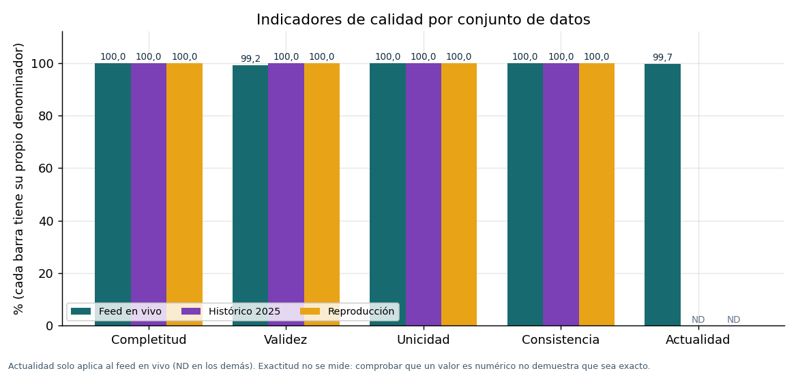
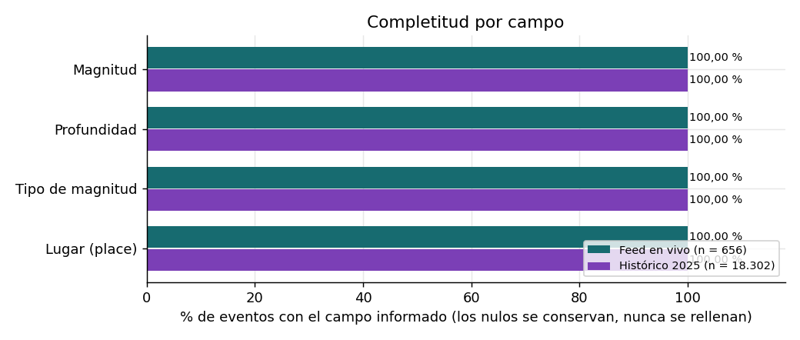
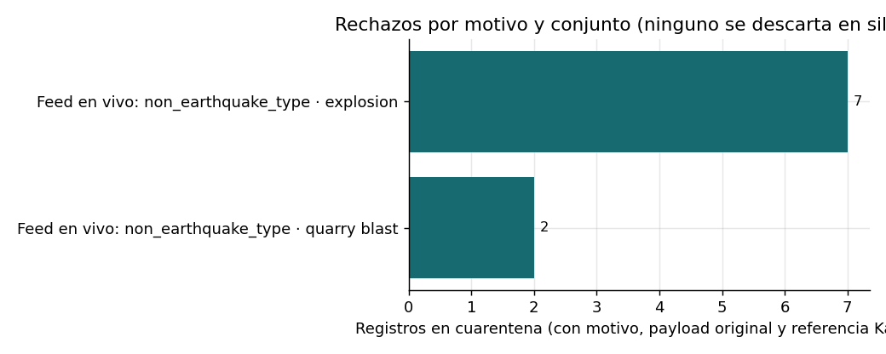
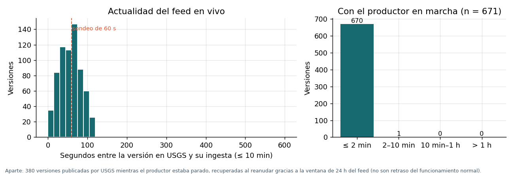
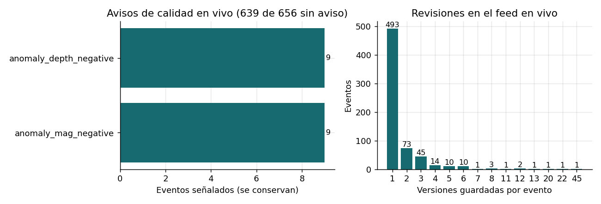

# Análisis de calidad de los datos (visual)

Generado por [`scripts/graficos_calidad.py`](../scripts/graficos_calidad.py) contra PostgreSQL real el 2026-11-19 20:31:22 UTC
(cifras en [`docs/evidencias/calidad/calidad-datos.json`](evidencias/calidad/calidad-datos.json)). Complementa a la memoria (§3), que contiene la comparación
**antes/después** con los archivos originales, las reglas aplicadas y ejemplos reales; aquí se resume en gráficos el
estado actual de cada conjunto. Las cifras del feed en vivo cambian con el tiempo: es una instantánea.

Para regenerarlo (matplotlib se instala solo en el contenedor efímero, no en la imagen):

```bash
docker compose run --rm --no-deps -v "${PWD}/scripts:/app/scripts" -v "${PWD}/docs:/app/docs" api \
    sh -c "pip install -q --target /tmp/mpl matplotlib==3.10.9 && PYTHONPATH=/tmp/mpl MPLCONFIGDIR=/tmp/mplcfg python scripts/graficos_calidad.py"
```

## 1. Indicadores por dimensión y conjunto

Cada celda es un cociente con su numerador y su denominador. **No se calcula una nota global**: mezclaría denominadores
distintos (eventos, versiones) y sumaría incidencias que pueden solaparse, que es justo lo que la guía de entrega pide evitar.

| Dimensión | Definición (numerador / denominador) | Feed en vivo | Histórico 2025 | Reproducción |
|---|---|---:|---:|---:|
| **Completitud** | eventos con magnitud, profundidad, tipo de magnitud y lugar / eventos | 100,00 % (630 / 630) | 100,00 % (18.302 / 18.302) | 100,00 % (10 / 10) |
| **Validez** | versiones aceptadas / versiones aceptadas + rechazadas (cuarentena) | 99,15 % (1.051 / 1.060) | 100,00 % (18.302 / 18.302) | 100,00 % (11 / 11) |
| **Unicidad** | pares (event_id, updated) distintos / versiones guardadas | 100,00 % (1.051 / 1.051) | 100,00 % (18.302 / 18.302) | 100,00 % (11 / 11) |
| **Consistencia** | eventos cuya versión vigente es la más reciente recibida / eventos | 100,00 % (630 / 630) | 100,00 % (18.302 / 18.302) | 100,00 % (10 / 10) |
| **Actualidad** | versiones guardadas ≤ 2 min después de su `updated` / versiones publicadas con el productor en marcha | 99,85 % (670 / 671) | ND (no aplica) | ND (no aplica) |
| **Exactitud** | No medible con los datos disponibles | ND | ND | ND |



**Lectura.** Unicidad y consistencia son del 100 % en los tres conjuntos porque las garantiza la base de datos
(`UNIQUE (event_id, updated_ms)` y la guardia del upsert), no porque se hayan limpiado a mano. La validez del feed en vivo
es la única por debajo del 100 %: son los no-terremotos que la regla de tipo manda a cuarentena. **Exactitud** no se puede
medir: comprobar que una magnitud es numérica y está en rango no demuestra que sea correcta (memoria §3.7); lo único
contrastable es la atribución de país, que se verifica en la memoria §3.6.

## 2. Completitud por campo



| Campo | Feed en vivo (n = 630) | Histórico 2025 (n = 18.302) | Decisión |
|---|---:|---:|---|
| Magnitud | 630 | 18.302 | Un nulo se conserva como `null` (ND): no se sustituye por 0, que alteraría medias y umbrales |
| Profundidad | 630 | 18.302 | Igual: ND en el panel y fuera del histograma, con el recuento de ausentes declarado |
| Tipo de magnitud | 630 | 18.302 | Se conserva tal cual (normalizado a minúsculas si llega en mayúsculas) |
| Lugar | 630 | 18.302 | Se recortan espacios; nunca se usa para asignar país |

## 3. Rechazos (cuarentena)



| Conjunto | Motivo | Detalle | Registros |
|---|---|---|---:|
| Feed en vivo | `non_earthquake_type` | explosion | 7 |
| Feed en vivo | `non_earthquake_type` | quarry blast | 2 |

Cada rechazo conserva el motivo, el payload original y la referencia Kafka (topic, partición, offset); ninguno aparece en
el mapa ni en las estadísticas. Histórico: 0 rechazos (catálogo ya filtrado por `eventtype=earthquake`).
Reproducción: 0 (sus casos controlados de duplicado y versión antigua no son errores: se resuelven como
`DUPLICATE` y `STALE` y no se guardan). Los registros artificialmente dañados viven en las pruebas, no en estos conjuntos.

## 4. Actualidad del feed en vivo



Se mide sobre las 671 versiones que USGS publicó **con el productor en marcha** (hubo una consulta correcta en
los 120 s anteriores): **670 (99,8 %) entraron en la base menos de 2 minutos después**
(mediana 58 s, p95 101 s). El reparto se concentra por debajo de 120 s porque el productor consulta
el feed cada minuto. Aparte quedan 380 versiones publicadas mientras el productor estaba parado
(arranques y el hueco de ingesta de la memoria §2.3): se recuperaron al reanudar gracias a la ventana de 24 h del feed, y
contarlas como retraso confundiría una parada con lentitud del sistema.
Esto mide **nuestro** retraso; el retraso de publicación de USGS (ocurrencia → primera versión) se analiza en la memoria §3.5.

## 5. Avisos de calidad y revisiones



Los avisos (`quality_flags`) **no rechazan** el evento: señalan valores válidos pero llamativos (magnitud o profundidad
negativas, que son posibles en sismología) o transformaciones aplicadas (espacios recortados). En el feed en vivo,
613 de 630 eventos no tienen ningún aviso; en el histórico, 18.299 de 18.302.

Revisiones: 149 de 630 eventos en vivo tienen más de una versión (máximo 45). Cada versión se guarda en
`event_message` y solo la más reciente pasa a `event_current`; una versión antigua que llegue tarde no la sustituye.
