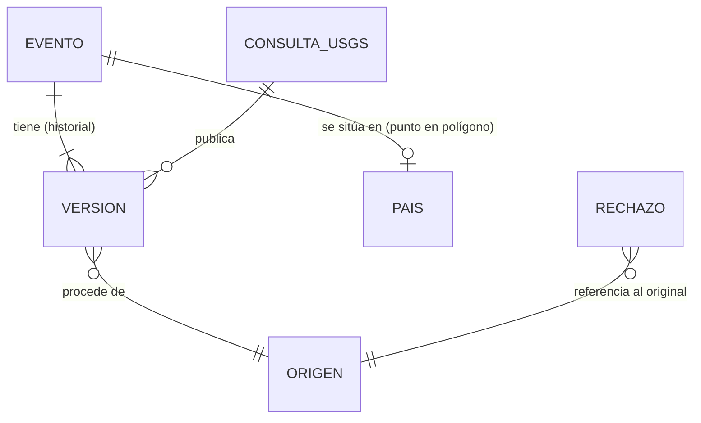

# Observatorio de actividad sísmica: memoria técnica

Proyecto de aula de Big Data. Canalización de cinco servicios (productor → Kafka → consumidor → PostgreSQL → API) y panel Angular/Leaflet publicado en Netlify a través de un túnel ngrok.

**Cómo leer este documento.** Cada apartado responde a un criterio de la rúbrica (ENUNCIADO §13). Todas las cifras proceden de scripts reproducibles (§10); ninguna se escribió a mano. Las cifras del feed en vivo son una **instantánea del 2026-11-18 20:53 UTC** y se regeneran con `scripts/memoria_datos.py`.

| Criterio de la rúbrica | Apartado | Evidencia principal |
|---|---|---|
| Extracción | §2 | `docs/consultas-y-procedencia.md`, `data/README.md`, `docs/evidencias/memoria-datos.json` |
| Calidad | §3 | §3 (código, consultas, antes/después, ejemplos), `docs/fase8-calidad-y-geografia.md` |
| Modelado | §4 | `docs/diccionario-de-datos.md`, `backend/db/` |
| Análisis | §5 | `docs/evidencias/analisis/*.png`, `memoria-datos.json`, `comparacion-reciente.json` |
| Reflexión | §6, §7, §8 | `docs/evidencias/complejidad.md`, `api-latencia.json` |
| Pruebas de aceptación | §9 | `docs/evidencias/aceptacion-s11.md`, `pila-real.md`, `panel*.md` |

---

## 1. Arquitectura, decisiones y despliegue

Cinco servicios Docker Compose, y solo cinco:

```
USGS ──HTTP/60 s──► productor ──► Kafka ──► consumidor ──► PostgreSQL ◄── API (FastAPI) ◄──HTTPS (CORS)── panel Angular (Netlify)
 (feed + FDSN)        (Python)    (KRaft)    (Python)      (esquema por modo)        └── ngrok (dominio fijo) ──┘
```

| Decisión | Motivo |
|---|---|
| **Un topic y un esquema PostgreSQL por modo** (`demo`, `live`, `replay`; `historico` para la instantánea 2025) | Aislamiento verificable: la base rechaza con `CHECK` un modo ajeno, aunque se intente con SQL directo (prueba en `tests/acceptance`) |
| **El productor publica todo; el consumidor es el único punto de rechazo** | Nada se descarta en silencio: cada rechazo queda en `quarantine_record` con motivo y referencia al original |
| **Versionado por `(event_id, updated)`** con upsert protegido (`WHERE current_version_ms < EXCLUDED.current_version_ms`) | Idempotencia: reenviar un mensaje no cambia el estado; una versión antigua no sustituye a la vigente |
| **Offsets confirmados solo después del COMMIT** | Procesamiento al menos una vez con escritura idempotente (sin transacción distribuida) |
| **País solo por punto en polígono** (nunca por `place` ni por cercanía) | Lo exige el enunciado y se demostró que el texto da resultados erróneos (§3.6) |
| **Gráficos SVG hechos a mano**, sin librerías | Menos dependencias y control total del tratamiento de nulos (ND) |
| **Histórico por script de descarga + cargador**, sin sexto servicio | Se respeta el límite de cinco servicios |

**Seguridad y exposición.** Solo la API se publica, en `127.0.0.1:8000`; Kafka y PostgreSQL no tienen puertos publicados. La API solo tiene tres rutas de lectura (`/api/eventos`, `/api/estadisticas`, `/api/salud`), sin documentación interactiva ni administración. CORS usa orígenes exactos (nunca `*`) desde `CORS_ORIGINS`. El authtoken de ngrok vive en el perfil del usuario, fuera de Git y del frontend; `config.json`, que es público, solo contiene la URL pública del túnel. Kafka conserva 168 h o 1 GiB por topic y los datos están en volúmenes persistentes.

**Despliegue.** Panel: `https://observatorio-sismico-elena.netlify.app`; API: dominio fijo gratuito de ngrok. Procedimiento, checklist de defensa y tabla de fallos en `docs/despliegue.md`.

---

## 2. Extracción e ingesta

### 2.1 Fuentes, tipos y unidades

| Fuente | Contenido | Acceso | Registro |
|---|---|---|---|
| Feed USGS `all_day.geojson` | Ventana móvil de 24 h, cada respuesta repite toda la ventana | GET cada 60 s | `ingest.extraction_log` |
| API FDSN de USGS | Histórico 2025, mundo, M ≥ 4, `eventtype=earthquake` | 12 consultas mensuales | `data/raw/historico/manifest.json` |
| API FDSN de USGS (periodo reciente) | 1-oct → 18-nov-2026 (exclusivo), mismos filtros que el histórico, para la comparación equivalente (§5, conclusión 4) | 2 consultas (una por mes) | `data/raw/reciente/manifest.json` |
| Natural Earth 1:110M | 177 entidades con `ADM0_A3`, `NAME_ES`, `SUBREGION`… | Copia entregada (SHA-256 verificado) | `ref.dim_country` |

Tipos y unidades de los campos de USGS (identificador, `time` y `updated` en **ms Unix UTC**, coordenadas **lon, lat, profundidad en km**, magnitud adimensional con tipo, `place` descriptivo, `type`) y cuáles son opcionales (`mag`, `magType`, `place`, profundidad) están en `docs/diccionario-de-datos.md` §1.

### 2.2 Automatización y robustez

- Variables de entorno para dirección Kafka, topics, frecuencia y modo (`.env.example`).
- Cliente HTTP con timeout, reintentos con espera progresiva, `Retry-After` en HTTP 429/5xx y control de JSON inválido. Un fallo se registra **sin borrar** el estado válido anterior.
- Se conserva el GeoJSON original comprimido antes de transformarlo (`data/raw/live/AAAA/MM/DD/HHMMSS.geojson.gz`, retención 14 días). **No se guardan copias idénticas**: el hash se calcula sobre las `features` y no sobre los bytes, porque `metadata.generated` cambia cada minuto.
- La versión se marca como publicada **solo tras el ack de Kafka**. Si el proceso cae entre ambas operaciones, se reenvía y el consumidor lo tolera (prueba `test_crash_between_ack_and_mark_republishes_and_consumer_tolerates_it`).
- La clave Kafka es `event_id`; el mensaje lleva `source`, `ingested_at`, `mode` y el evento original sin modificar.

### 2.3 Resultados medidos

**Feed en vivo** (189 consultas correctas, 0 fallidas, entre 2026-11-17 22:15 y 2026-11-18 20:52 UTC):

| Medida | Valor |
|---|---|
| Latencia de la consulta | media 123,7 ms · p95 154,6 ms · máx 564 ms |
| Apariciones de features en las respuestas | 35.621 |
| Versiones publicadas a Kafka (incluidas las rechazadas) | 471 |
| **Publicaciones evitadas** por la marca de «ya publicado» | **98,7 %** |
| Respuestas sin copia por ser idénticas | 99 de 189 (90 archivos distintos) |

Sin la deduplicación del productor, cada versión se republicaría unas 76 veces de media (35.621 apariciones para 471 versiones: una por minuto mientras el evento permanece en la ventana de 24 h).

**Histórico 2025:** 12 consultas, 18.302 eventos recibidos y reportados (coinciden), ninguna se acerca al límite de 20.000 (la mayor, julio, trae 2.684), 0 duplicados entre intervalos. Tabla completa con URL, fecha de extracción, tamaño y SHA-256 en `docs/consultas-y-procedencia.md`.

**Hueco de ingesta.** El productor live estuvo parado 19,5 h (del 17-nov 22:19 al 18-nov 17:49 UTC). Como es menor que la ventana de 24 h del feed, **no se perdió ningún evento**: al reanudar, el primer ciclo publicó los eventos que faltaban (155 nuevos). Un hueco **mayor de 24 h** no se recupera con el feed: se descarga el intervalo con el catálogo FDSN (`history_download`) y se carga como histórico (`data/README.md`).

**Limitación declarada.** «No aparece en la siguiente ventana» no significa que USGS lo haya eliminado: puede haber envejecido más de 24 h, así que el histórico almacenado no se borra. La reconciliación exhaustiva de eventos eliminados o fusionados fuera del feed es una ampliación fuera del alcance.

---

## 3. Calidad y transformación

El consumidor aplica reglas explícitas (`backend/consumer/processing.py`, `quality.py`, `geo.py`). Cada decisión está documentada en `docs/fase8-calidad-y-geografia.md`; aquí se presentan los resultados **antes y después** en las seis dimensiones.

### 3.1 Qué se rechaza, qué se señala y qué se transforma

| Situación | Tratamiento |
|---|---|
| JSON ilegible, esquema inválido, coordenadas fuera de rango o no finitas, geometría que no es Point | **Cuarentena** con motivo y payload original |
| `type` distinto de `earthquake` | **Cuarentena** `non_earthquake_type` (con el tipo en el detalle) |
| Mensaje de un modo en el topic de otro | **Cuarentena** `mode_mismatch` |
| Magnitud o profundidad ausentes | Se conserva **NULL** (ND). Nunca se rellena con 0 |
| Magnitud o profundidad **negativas** | Válidas: se conservan y se señalan (`anomaly_*`) |
| Espacios en `place`, `place` vacío, `magType` en mayúsculas | **Transformación** registrada (`fixed_*`) |
| Epicentro fuera de todo polígono | **Sin país asignado**: se conserva y permanece en el análisis |

### 3.2 Resultados por dimensión: antes y después

*Antes* = archivos originales de USGS sin transformar (`data/raw`); *después* = estado en PostgreSQL. Script: `scripts/memoria_datos.py`.

| Dimensión | Comprobación | Antes (original) | Después (base de datos) | Decisión |
|---|---|---|---|---|
| **Completitud** | Magnitud nula / magType ausente / profundidad nula / `place` vacío (histórico, 18.302) | 0 / 0 / 0 / 0 | 0 / 0 / 0 (y **0 magnitudes convertidas en 0**) | NULL se conserva; no se imputa |
| | Magnitud nula en el feed live (402 eventos) | — | 0 | Los NULL se contarían aparte (`null_mag_excluded`) si aparecieran |
| **Unicidad** | Duplicados entre intervalos del histórico | 0 de 18.302 leídos | 18.302 `event_id` únicos | Deduplicar por `event_id` al unir intervalos |
| | Repetición del feed (35.621 apariciones) | 35.621 | **471** versiones publicadas (−98,7 %) | Marca «ya publicado» tras el ack |
| | Reenvío de versiones y reproceso de offsets | — | `UNIQUE (event_id, updated_ms)`: 0 duplicados en las pruebas P2, P4 y P8 | Upsert idempotente |
| **Validez** | Tipo distinto de `earthquake` (feed live) | 5 (3 `explosion`, 2 `quarry blast`) | **5 en cuarentena**, 0 en `event_current` | Cuarentena con motivo |
| | Coordenadas no finitas o fuera de rango, no Point (histórico) | 0 | 0 | `CHECK` en base de datos además de la validación |
| | Fechas y estructura | 0 `updated` anterior a `time` | 0 avisos `anomaly_updated_before_time` | — |
| **Consistencia** | Países inexistentes en el catálogo | — | 0 (clave foránea a `ref.dim_country`) | Clave foránea + `CHECK assigned ⇔ country_id` |
| | `event_current` sin mensaje de origen | — | 0 (clave foránea compuesta) | Integridad referencial |
| | Secuencia de revisiones (versión vigente = la mayor) | — | 0 eventos con la vigente distinta de la última (64 revisiones en live) | Guardia `WHERE current_version_ms < EXCLUDED…` |
| | `ADM0_A3` único | — | 177 de 177 | Se comprueba antes de cargar |
| **Actualidad** | Retraso de nuestra ingesta tras la actualización de USGS (fuera de arranque, n=86) | — | mediana 56 s · p95 90 s · máx 120 s | Coherente con el sondeo de 60 s |
| | Retraso de publicación de USGS (ocurrencia → primera versión; fuera de arranque, n=28) | — | mediana 3,1 min · p95 536 min · máx 786 min | **Cola larga**: algunos eventos se publican horas después (ver §3.5) |
| **Exactitud** | Qué se puede contrastar | Atribución de país vs `place` (§3.6) | Epicentros marítimos y fronteras explicados | Se documenta lo que **no** se puede verificar (§3.7) |

Avisos de calidad del histórico: **18.299 de 18.302 sin aviso**; solo `fixed_place_trimmed` en 3 (0,02 %). Un catálogo oficial ya curado deja poco que limpiar: es un resultado, no una ausencia de análisis. En el feed live aparecieron 5 magnitudes negativas válidas (con `anomaly_mag_negative`) y 5 no-terremotos, que la regla aísla.

### 3.3 Consultas para reproducir las cifras

```sql
-- Completitud por campo (histórico)
SELECT count(*) AS total, count(mag) AS con_mag, count(mag_type) AS con_tipo, count(depth_km) AS con_prof,
       count(*) FILTER (WHERE mag = 0) AS mag_cero
FROM historico.event_current;

-- Cuántos registros afecta cada regla (y los que no tienen aviso)
SELECT code, count(*) FROM historico.event_current, unnest(quality_flags) code GROUP BY 1 ORDER BY 2 DESC;
SELECT count(*) FROM historico.event_current WHERE cardinality(quality_flags) = 0;

-- Unicidad y secuencia de versiones
SELECT count(*) - count(DISTINCT event_id) FROM historico.event_current;
SELECT count(*) FROM live.event_current c
 WHERE c.current_version_ms <> (SELECT max(updated_ms) FROM live.event_message WHERE event_id = c.event_id);

-- Rechazos y su motivo (con referencia al original)
SELECT left(reason, strpos(reason, ':') - 1) AS motivo, count(*) FROM live.quarantine_record GROUP BY 1;
```

### 3.4 Registros de ejemplo reales

**Rechazo en cuarentena** (`live.quarantine_record`, id 1):
`event_id = uw714139751`, `reason = non_earthquake_type: properties.type='explosion', expected 'earthquake'`, referencia Kafka `sismos.live/0@214`, `original_payload` con el sobre íntegro («8 km S of Princeton, Canada», M2,21). No aparece en el mapa ni en las estadísticas.

**Magnitud y profundidad negativas, conservadas y señaladas:** `av94503618`, M −0,58 (`ml`), profundidad negativa, `quality_flags = {anomaly_mag_negative, anomaly_depth_negative}`, «63 km ENE of Pedro Bay, Alaska». Una magnitud negativa es válida en sismología (eventos muy pequeños) y una profundidad negativa puede indicar posición sobre el nivel de referencia: no se rechazan sin estudiar su significado.

**Revisión que cambia datos (`live.event_message`):** el evento `aka2026wupwhh` tuvo dos versiones. La primera (publicada a las 20:30:50 UTC) decía M0,9 con epicentro en [−154,699; 58,464]; la segunda (a las 05:55:34 UTC del día siguiente, 9 h después) lo dejó en **M3,5 en [−150,383; 56,040]**, unos 300 km al sur-este, con la hora de ocurrencia corregida en 10 s. En `event_current` solo queda la segunda (y el país se recalcula con la nueva posición); `event_message` conserva ambas. Esto confirma por qué las agregaciones se calculan desde `event_current` y no sumando mensajes.

**Casos artificialmente dañados**, separados e identificados: no se mezclan con datos reales. Viven en las pruebas (`tests/unit/test_processing.py`, `tests/acceptance`) y en el modo `demo`/`replay` (`synthetic_flag = true`, `source = replay-injected`).

### 3.5 Revisiones y actualidad (feed live, instantánea)

De 402 eventos, **31 tuvieron revisiones** (64 versiones posteriores a la primera). Entre versiones consecutivas: la magnitud cambia en 17, la ubicación en 15 y el tiempo de ocurrencia en 15; el mayor cambio de magnitud fue de 2,6; la mediana entre versiones es de 17,9 min. Una revisión puede por tanto mover un evento de país, de magnitud o de ventana horaria.

Retraso de publicación de USGS (minutos entre la ocurrencia y la primera versión vista, **solo ciclos de funcionamiento normal**; se excluye el ciclo de arranque, que publica de golpe las 24 h anteriores y falsearía el dato): n = 28, mediana 3,1 min, p95 536 min; con M ≥ 4, n = 5 y mediana 25,5 min (frente a 1,6 min por debajo de M 4). Con **muestra todavía pequeña (n = 28; solo 5 de M ≥ 4)** no se estima un retraso medio fiable; sí se observa que **la distribución tiene cola larga**: algunos eventos aparecen horas después de ocurrir. Por eso la comparación de «últimas 24 horas» puede infravalorar el recuento reciente, como exige advertir el enunciado.

**Madurez del catálogo (medida con el catálogo FDSN reciente, §5 conclusión 4).** El retraso no afecta solo a las primeras horas: descargado el 18-nov, el catálogo tiene entre el 29-oct y el 17-nov una media de **26,4 eventos M ≥ 4 por día**, frente a 53,5 entre el 1 y el 28-oct, y ese total queda **por debajo del mínimo de cualquier ventana de 20 días de 2025**. La caída es brusca, empieza unas tres semanas antes de la descarga y es más fuerte en M 4,0–4,4 (de 23,5 a 10,4 por día) que en M ≥ 4,5 (de 30,0 a 16,1). Es coherente con un catálogo que todavía se está completando; que la actividad mundial cayera a la vez en las dos bandas es mucho menos probable, pero **no queda demostrado**: se comprueba volviendo a descargar el mismo periodo más tarde (`RECIENTE_SNAPSHOT=reciente-2`, §10) y midiendo cuántos eventos aparecen en esos días.

### 3.6 Atribución de país: regla y verificación

Punto en polígono sobre Natural Earth (Shapely `STRtree`, predicado `covered_by`, WGS84 sin reproyectar):

1. **Solo geometría.** `place` y la cercanía nunca deciden el país.
2. **Frontera:** un punto sobre el borde cuenta como dentro.
3. **Varias coincidencias:** gana el menor `ADM0_A3` alfabético (determinista) y se registra `country_boundary_ambiguous`. Ejemplo verificado: el vértice España-Francia (−1,901351; 43,422802) → `ESP`.
4. **Antimeridiano:** el catálogo parte los polígonos en ±180°; `lon = 180` y `lon = −180` caen cada uno en su pieza (verificado con Rusia y Fiyi).
5. **Geometrías inválidas:** 2 de 177 (USA y SDN) se reparan con `make_valid` (el área no cambia).
6. **Sin país:** se conserva «Sin país asignado» (`country_status = unassigned`); no es un error ni se atribuye al más cercano.

**Resultado sobre 2025:** 3.952 eventos con país (21,6 %) y **14.350 sin país (78,4 %)**. Para comprobar que no es un fallo se contrastó con el texto `place` **solo como verificación**: de 13.423 eventos cuyo `place` nombra un país, 9.833 quedan sin país con una **mediana de 105 km** a la costa de ese país (10,7 % a menos de 25 km, 22,3 % a menos de 50 km, 34,2 % entre 100 y 200 km). Son epicentros marítimos del estilo «90 km W de Valparaíso, Chile». Además, 239 eventos se asignaron a un país distinto del que nombra el texto (fronteras: 56 en China con `place` de Nepal, 32 en Bolivia con `place` de Chile). Atribuir por texto habría colocado unos 9.800 eventos marítimos dentro de países que no los contienen y habría movido otros 239 al país equivocado.

### 3.7 Exactitud: qué se puede y qué no se puede verificar

- **Verificable:** estructura, rangos, unicidad, coherencia entre versiones, consistencia con el catálogo geográfico y el contraste de `place` con la geometría.
- **No verificable aquí:** la magnitud y la posición reales (dependen de USGS y de cada red sísmica), la completitud del catálogo (§5, conclusión 1) y los tipos de magnitud, que son **mixtos** (89,2 % `mb`, 8,1 % `mww` en 2025; en el feed live predominan `ml` y `md`, magnitudes regionales de eventos pequeños).
- **Mapa simplificado:** escala 1:110M, sin islas menores (Taveuni, en Fiyi, queda sin país). Un evento costero puede quedar «sin país» por simplificación; la franja de menos de 25–50 km a la costa podría deberse a ello.

---

## 4. Integración y modelado

### 4.1 Modelo conceptual



Un **evento** (terremoto identificado por `event_id`) tiene varias **versiones** (cada revisión de USGS, identificada por `updated`). Cada evento se sitúa, como máximo, en un **país** del catálogo (puede no tener ninguno). Lo que no se puede aceptar va a **rechazo**, con referencia al original.

### 4.2 Modelo lógico y grano

| Entidad | Tabla | Grano | Clave |
|---|---|---|---|
| Hecho **evento actual** | `<modo>.event_current` | una fila por `event_id` | `event_id` (PK); FK compuesta a la versión vigente; FK a `ref.dim_country` |
| **Historial de versiones** | `<modo>.event_message` | una fila por `(event_id, updated_ms)` | `message_id`; `UNIQUE (event_id, updated_ms)` |
| Dimensión **país** | `ref.dim_country` | una fila por entidad Natural Earth | `country_id` = `ADM0_A3` |
| **Rechazos** | `<modo>.quarantine_record` | una fila por registro rechazado | `quarantine_id`; único por offset Kafka |
| Estado de **ingesta** | `ingest.published_version`, `ingest.extraction_log` | una por versión publicada / una por consulta | `(mode, event_id, updated_ms)` / `extraction_id` |

No se crea una `dim_date`: las ventanas de una hora UTC salen de `time_ms` con aritmética entera (`time_ms / 3600000`). Se evita una tabla adicional que no aporta información.

### 4.3 Modelo físico (SQL esencial)

```sql
CREATE TABLE live.event_message (
  message_id    BIGINT GENERATED BY DEFAULT AS IDENTITY PRIMARY KEY,
  event_id      TEXT NOT NULL CHECK (length(trim(event_id)) > 0),
  updated_ms    BIGINT NOT NULL CHECK (updated_ms >= 0),
  source TEXT NOT NULL, mode TEXT NOT NULL, ingested_at TIMESTAMPTZ NOT NULL,
  synthetic_flag BOOLEAN NOT NULL, payload JSONB NOT NULL CHECK (jsonb_typeof(payload) = 'object'),
  replay_at TIMESTAMPTZ,
  CONSTRAINT ck_event_message_schema_mode CHECK (mode = 'live'),                 -- aislamiento por modo
  CONSTRAINT ck_event_message_replay_at  CHECK ((mode = 'replay') = (replay_at IS NOT NULL)),
  CONSTRAINT uq_event_message_version    UNIQUE (event_id, updated_ms),          -- idempotencia
  CONSTRAINT uq_event_message_reference  UNIQUE (message_id, event_id, updated_ms)
);

CREATE TABLE live.event_current (
  event_id TEXT PRIMARY KEY, message_id BIGINT NOT NULL, current_version_ms BIGINT NOT NULL,
  last_seen_at TIMESTAMPTZ NOT NULL, time_ms BIGINT NOT NULL CHECK (time_ms >= 0),
  mag DOUBLE PRECISION, mag_type TEXT, depth_km DOUBLE PRECISION,
  lon DOUBLE PRECISION NOT NULL CHECK (lon BETWEEN -180 AND 180), lat DOUBLE PRECISION NOT NULL CHECK (lat BETWEEN -90 AND 90),
  place TEXT, event_type TEXT NOT NULL, ingested_at TIMESTAMPTZ NOT NULL,
  country_id TEXT REFERENCES ref.dim_country(country_id), country_status TEXT NOT NULL DEFAULT 'pending',
  quality_flags TEXT[],
  CONSTRAINT ck_event_current_country_consistency CHECK ((country_status = 'assigned') = (country_id IS NOT NULL)),
  CONSTRAINT fk_event_current_message FOREIGN KEY (message_id, event_id, current_version_ms)
    REFERENCES live.event_message (message_id, event_id, updated_ms) ON DELETE RESTRICT   -- apunta a una versión REAL del mismo evento
);
```

### 4.4 Idempotencia y revisiones

El consumidor clasifica cada mensaje (`classify_version`): `NEW`, `DUPLICATE` (misma versión), `REVISION` (`updated` mayor) o `STALE` (menor). La versión se guarda siempre en `event_message` sin sobrescribir ninguna; `event_current` solo cambia si la nueva es **estrictamente mayor**, con una guardia en el propio `UPSERT`, de modo que incluso dos consumidores concurrentes no pueden retroceder el estado. Todo ocurre en **una transacción**, y el offset de Kafka se confirma después del COMMIT. Si el mensaje se repite tras un fallo, las restricciones únicas y el upsert impiden que aumente el recuento (prueba de aceptación P2, P4 y P8).

### 4.5 Índices y su justificación

| Índice | Consulta que acelera | Evidencia medida (§6) |
|---|---|---|
| `UNIQUE (event_id, updated_ms)` en `event_message` | Búsqueda de versión por identificador (cada mensaje) y control de duplicados | 100.000 filas: 5,93 ms sin índice → **11,5 µs** con índice; 1.000.000: 58,6 ms → **27 µs** |
| `(time_ms DESC)` en `event_current` | Ventanas horarias y orden cronológico | Ventana de 24 h en 1.000.000 de filas: 36,5 ms (Seq Scan) → **2,3 ms** (Bitmap Index Scan) |
| `(country_id, time_ms DESC)` | Filtro por país y recuentos por país y hora | Mismo patrón que el anterior con filtro de país |
| `(mag)` parcial `WHERE mag IS NOT NULL` | `min_mag` (una magnitud nula nunca lo cumple, así que no se indexan los NULL) | Índice más pequeño y suficiente para el filtro |
| `(country_status)` | Contar y filtrar «sin país asignado» frente a `pending` | — |

Un índice de tiempo **no acelera** una agregación de todo el año (214 ms con y sin índice en 1.000.000 de filas): hay que leer todas las filas de todos modos. Por eso los índices se justifican por consulta, no por costumbre.

### 4.6 Integración geográfica y migraciones

La integración une cada evento con la dimensión país por geometría (no por texto), con la regla de §3.6. El esquema evoluciona con migraciones numeradas que **nunca se editan una vez aplicadas** (el migrador comprueba un checksum por migración y rechaza una modificada); las migraciones por esquema de modo se ejecutan una vez por cada uno.

---

## 5. Análisis y conclusiones

Todas las cifras proceden de `docs/evidencias/memoria-datos.json` (consultas en `scripts/memoria_datos.py`). **Muestras equivalentes:** el histórico solo contiene M ≥ 4, así que cualquier comparación con el feed live se hace con el mismo umbral (M ≥ 4) y con días UTC completos. Estas estadísticas describen eventos publicados por USGS: la cobertura de detección y los tipos de magnitud varían entre regiones y épocas, y **no son una predicción de terremotos ni una evaluación de riesgo**.

### Conclusión 1: el catálogo es completo a partir de M ≈ 4,5, y por debajo hay que interpretarlo con cuidado

**Datos:** histórico 2025, M ≥ 4, mundo, 18.302 eventos. Recuento acumulado: M ≥ 4,0: 18.302 · ≥ 4,5: 8.559 · ≥ 5,0: 2.129 · ≥ 5,5: 514 · ≥ 6,0: 145 · ≥ 6,5: 45 · ≥ 7,0: 16 · ≥ 8,0: 1 (máximo M8,8).
**Estimador de máxima verosimilitud (Aki-Utsu) del parámetro b de Gutenberg-Richter:**

| Magnitud de completitud supuesta | N | b | Error estándar |
|---|---:|---:|---:|
| 4,0 | 18.302 | **0,773** | 0,006 |
| 4,5 | 8.559 | **1,206** | 0,013 |
| 5,0 | 2.129 | **1,200** | 0,026 |

**Lectura:** a partir de M 4,5 el valor es estable (1,20–1,21) y consistente entre umbrales; con M 4,0 baja a 0,77. Una b que cae al incluir las magnitudes más pequeñas indica que el catálogo **está incompleto entre M 4,0 y 4,4**: faltan eventos pequeños que las redes no detectan o no publican en todas partes. Por tanto, cualquier recuento o media por día con M ≥ 4 está **ligeramente infravalorado en el tramo bajo**, y las comparaciones sólidas se hacen a partir de M 4,5. **Cautela:** el valor de b ≈ 1,2 es algo mayor que el ≈ 1,0 que suele citarse; con un 89 % de magnitudes `mb` (tipos de magnitud mezclados) no se interpreta como una propiedad física, sino como una característica de este catálogo.
**Captura:** los filtros del panel no ofrecen esta estimación (es un cálculo estadístico); se reproduce con el script. El histograma de magnitud del panel (`analisis/02-live-17nov-M4.png`) muestra la misma caída del recuento al subir la magnitud.

### Conclusión 2: la media diaria de 2025 (50,1) está inflada por la secuencia de réplicas de julio; la mediana (43) describe mejor un día típico

**Datos:** 365 días con los días sin eventos incluidos. Media **50,14**, mediana **43**, mínimo 20, máximo **645** (2025-07-30), cuartiles 36 y 53. Con la valla de Tukey (Q3 + 1,5·RIC = 78,5) hay **27 días atípicos que concentran 3.782 eventos (20,7 % del año)**; la media sin ellos es **42,96**, prácticamente la mediana. Julio (2.684 eventos) y agosto (2.222) tuvieron 2,0 y 1,7 veces la media del resto de meses (1.340).
**Lectura:** una sola jornada desplaza la media. El terremoto de **M8,8 de la península de Kamchatka** (`us6000qw60`, 2025-07-29 23:24 UTC) y sus réplicas dan 121 eventos el 29-jul, **645 el 30-jul**, 315 el 31-jul y 234 el 1-ago; los eventos de una secuencia no son independientes. **Consecuencia para el panel:** la comparación histórica devuelve media, mediana, mínimo y máximo, y la memoria compara con la mediana (43) además de con la media (50,1).
**Comparación con el feed** (M ≥ 4; día UTC completo 2026-11-17): **23 terremotos** en la instantánea de `memoria-datos.json` (24 dos horas después, al publicarse otro), es decir 0,46 veces la media y 0,53 veces la mediana de 2025; solo 4 de 365 días de 2025 tuvieron 23 o menos. **No indica menos actividad**: el catálogo FDSN da para ese mismo día 25 eventos, de los que el feed vio 24, así que el pipeline no pierde eventos; lo que ocurre es que **los días recientes de USGS aún no están completos** (conclusión 4). Comparar un día de hace horas con un año ya consolidado no es una comparación equivalente, y la tarjeta del panel lo advierte.
**Capturas:** `analisis/02-live-17nov-M4.png` (filtros: fechas 17-nov-2026, M ≥ 4) incluye la tarjeta de comparación histórica.

### Conclusión 3: el 78 % de los epicentros M ≥ 4 queda fuera de todo país, y casi todos los profundos

**Datos (2025, M ≥ 4):** 14.350 de 18.302 eventos (**78,4 %**) sin país asignado; entre los **1.102 eventos de 300 km o más, 1.077 (97,7 %)** están sin país. Profundidad: **74,8 %** (13.689) a menos de 70 km, 19,2 % entre 70 y 300 km y 6,0 % a 300 km o más (máxima 669,6 km; ninguna negativa). Países con más eventos asignados: China 354, Chile 348, Indonesia 306, Etiopía 265, Argentina 236. Por subregión: Sudamérica 973, Sudeste Asiático 580, Asia Oriental 548, Sur de Asia 443, África Oriental 290.
**Lectura:** la sismicidad se concentra en zonas de subducción y dorsales, en gran parte bajo el mar; por eso «Sin país asignado» es **el grupo más grande** y debe estar siempre en el análisis (no se descarta ni se reasigna). El contraste con `place` (§3.6) confirma que son epicentros marítimos y no un fallo del cruce.
**Muestra equivalente del feed** (M ≥ 4, día UTC 17-nov, n = 23): 60,9 % sin país (14 de 23), 56,5 % a menos de 70 km y 8,7 % a 300 km o más. Con n = 23 el error de una proporción ronda ±10 puntos, así que **no se puede afirmar que difiera del histórico**: es compatible con él en dirección (la mayoría sin país) pero no concluyente. Con una muestra mayor, el catálogo reciente (1-oct → 17-nov-2026, 2.027 eventos) da **70,4 %** sin país; el descenso se debe a la secuencia de Panamá, en tierra firme (conclusión 4): **excluyendo los 167 eventos a menos de 300 km del M7,7, la proporción es del 74,3 %**, cercana al 78,4 % de 2025. Profundidad: 73,2 % a menos de 70 km (74,8 % en 2025).
**Capturas:** `analisis/03-live-17nov-M4-sin-pais.png` (filtros: 17-nov-2026, M ≥ 4, país «Sin país asignado»: 14 eventos) y `analisis/04-live-17y18nov-pais-USA.png` (país USA). El total del mapa coincide con el de los gráficos en cada combinación (prueba E2E).

### Conclusión 4: en octubre de 2026 la actividad mundial M ≥ 4 fue normal salvo una secuencia en Panamá; los últimos 20 días todavía no son comparables

**Datos:** catálogo FDSN de USGS del 1-oct al 17-nov-2026 (48 días completos), **con los mismos filtros que el histórico** (mundo, M ≥ 4, `earthquake`, misma API y misma regla de punto en polígono), descargado el 18-nov-2026: **2.027 eventos**. Script: `scripts/comparacion_reciente.py` → `docs/evidencias/comparacion-reciente.json`. Para no confundir una secuencia de réplicas con un cambio real, cada total reciente se compara con **todas las ventanas de 2025 de la misma duración** (paso de un día) y se da su percentil.

| Tramo (2026) | Días | M ≥ 4 por día | Percentil en 2025 | M 4,0–4,4 por día (percentil) | M ≥ 4,5 por día (percentil) |
|---|---:|---:|---:|---:|---:|
| 1 → 28 oct | 28 | 53,5 | **80,5** | 23,5 (43,2) | 30,0 (89,6) |
| 29 oct → 17 nov | 20 | 26,4 | **0** (bajo el mínimo de 2025) | 10,4 (0) | 16,1 (3,5) |
| Total | 48 | 42,2 | 32,4 | 18,1 (0) | 24,2 (65,1) |
| *2025 (referencia)* | 365 | 50,1 (mediana 43) | — | 26,7 | 23,4 |

**Dónde:** el **M7,7 de Panamá** (`us6000u18k`, 2026-10-09 17:56 UTC, «10 km WSW of Pitaloza Arriba»), con réplicas de M6,6, M6,1 y M6,0, deja 167 eventos a menos de 300 km. **Centroamérica suma 140 eventos M ≥ 4 frente a 19 esperados con la tasa de 2025, por encima del máximo de cualquier ventana de 48 días de 2025 (39)**, y Panamá pasa a ser el país con más eventos asignados (120). Otros grandes eventos del periodo: M7,0 en el Tíbet (China, 22-oct), M6,9 en Kamchatka (16-oct), M6,8 en la dorsal mesoatlántica (13-oct) y M6,8 en Vanuatu (24-oct). Asia Oriental queda alta (103 frente a 72 esperados, percentil 96) pero dentro del rango de 2025 (máximo 177).
**Lectura:**
1. En el tramo **ya consolidado (1–28 oct)** la actividad mundial está en la parte alta de lo normal de 2025 (percentil 80,5), empujada por M ≥ 4,5 (percentil 89,6) y por la secuencia de Panamá; la banda M 4,0–4,4 es completamente normal (percentil 43). **No hay nada anómalo a escala mundial salvo secuencias localizadas**, igual que en 2025 con Kamchatka (conclusión 2).
2. El tramo **final (29 oct → 17 nov)** está por debajo de todo lo observado en 2025 en las dos bandas. Que caiga de golpe hace unas tres semanas, y más en las magnitudes pequeñas, apunta a un **catálogo todavía incompleto** y no a un cambio físico (§3.5). Consecuencia práctica: **cualquier comparación del periodo más reciente (incluida la de «últimas 24 horas» del panel) está sesgada a la baja** frente a un histórico consolidado.
3. Un recuento **por encima** del máximo de 2025 (Centroamérica) es robusto aunque falten eventos recientes, porque el sesgo va en la dirección contraria; un recuento **por debajo** (Sudeste Asiático, percentil 0) no se interpreta.

**Captura:** no hay captura del panel para esta conclusión: el catálogo reciente se analiza con el script y **no se carga en la base de datos**, para no mezclar una descarga del catálogo con los datos live (que son los que muestra el panel). El efecto de la secuencia de Panamá no es visible en el panel live porque es anterior a su ventana.

**Cautela:** describe eventos publicados por USGS; la cobertura de detección varía por región, y no es una predicción ni una evaluación de riesgo. El mismo periodo del calendario de 2025 (1-oct → 17-nov) tuvo 48,4 eventos por día, en línea con el resto del año.

### Resultado complementario (cautela): no hay un ciclo horario interpretable

Recuento 2025 por hora UTC de ocurrencia: máximo 832 (03 h), mínimo 681 (15 h), esperado bajo uniformidad 762,6. El test χ² (23 grados de libertad) da **41,1 frente a un valor crítico de 35,17 al 5 %**: formalmente se rechaza la uniformidad. Pero el efecto es pequeño (el cociente máximo/mínimo es 1,22) y el test supone eventos independientes, cosa que no se cumple con réplicas, que además agrupan eventos en pocas horas. **No se interpreta como un ciclo diario físico.** Se presenta como resultado honesto y no como conclusión.

### Qué se puede decir y qué no

Se puede afirmar: completitud del catálogo desde M ≈ 4,5; sesgo de la media de 2025 por una secuencia concreta; predominio de epicentros marítimos y superficiales (también en 2026); actividad mundial normal en octubre de 2026, con una secuencia excepcional en Panamá; y que los días más recientes del catálogo están incompletos, de modo que comparar el periodo reciente con un histórico consolidado lo infravalora. **No** se puede afirmar que la actividad de las últimas semanas sea menor que la de 2025 (el déficit es coherente con publicación tardía, pendiente de confirmar con una segunda descarga), ni dar un retraso medio de publicación fiable con la muestra del feed.

---

## 6. Complejidad, rendimiento y memoria

Mediciones reproducibles (`scripts/medir_complejidad.py`, `scripts/medir_api.py`). Datos **sintéticos** (`syn-N`, puntos aleatorios, tiempos repartidos en un año) en una base temporal `bench_synthetic_*` que se elimina al terminar; nunca se mezclan con los datos reales.

**Equipo y procedimiento.** HP Laptop 14s-dq2xxx, Intel Core i3-1115G4 (2 núcleos, 4 hilos, 3,0 GHz), 15,7 GiB de RAM, SSD de 238 GB, Windows 11 Home, Docker 27.1.1 (Docker Desktop sobre WSL2; el contenedor ve 4 hilos y 7,6 GiB). Python 3.12.16, Shapely 2.2.0, PostgreSQL 17.2. Mediana de 5 repeticiones (3 en las medidas muy lentas). La pila completa estaba en funcionamiento durante las mediciones, de modo que hay algo de ruido. Memoria: `tracemalloc` para estructuras Python y RSS del proceso para GEOS (código C, invisible a `tracemalloc`). El tiempo de PostgreSQL es el de ejecución en el servidor (`EXPLAIN ANALYZE`), sin el viaje de red.

### 6.1 Búsqueda de versiones por identificador

Tiempo por búsqueda (mitad aciertos en posición aleatoria, mitad fallos = peor caso):

| N | Lista (secuencial) | Diccionario | PostgreSQL sin índice | PostgreSQL con índice único | Memoria lista | Memoria dict | Tabla | Índice |
|---:|---:|---:|---:|---:|---:|---:|---:|---:|
| 1.000 | 26,9 µs | 0,06 µs | 58 µs | 8 µs | 0,14 MiB | 0,10 MiB | 0,05 MiB | 0,05 MiB |
| 10.000 | 292 µs | 0,06 µs | 579 µs | 11 µs | 1,37 MiB | 1,01 MiB | 0,57 MiB | 0,4 MiB |
| 100.000 | 2,74 ms | 0,05 µs | 5,93 ms | 11,5 µs | 14,2 MiB | 12,7 MiB | 5,7 MiB | 3,9 MiB |
| 1.000.000 | 31,3 ms | 0,06 µs | 58,6 ms (Gather) | 27 µs | 144 MiB | 112 MiB | 57,4 MiB | 38,7 MiB |

**Complejidad:** lista **O(n)** (media n/2, peor caso n): al multiplicar N por 1.000 el tiempo se multiplica por ≈1.170, linealidad observada. Diccionario **O(1)** medio (O(n) teórico con colisiones adversas): plano. PostgreSQL sin índice **O(n)** (Seq Scan; a 1.000.000 usa trabajadores paralelos). B-tree **O(log n)** en medio y peor caso: de 8 a 27 µs para 1.000× más filas (el salto de 11,5 a 27 µs a 1.000.000 incluye ruido y la profundidad extra del árbol).
**Decisión del proyecto:** el estado de versiones **no se guarda en memoria del proceso** sino en PostgreSQL con índice único: un diccionario ocuparía unos 112 MiB por millón de claves (≈11 GiB para 100 M), que no cabe en un portátil de 16 GiB y se pierde al reiniciar, mientras que el índice da la misma garantía de unicidad y persistencia.

### 6.2 Integración geográfica (punto en polígono, 177 polígonos)

| Puntos | Recorrido de los 177 polígonos | STRtree | Aceleración | STRtree (puntos/s) |
|---:|---:|---:|---:|---:|
| 1.000 | 58,8 ms | 13,5 ms | 4,4× | 74.046 |
| 5.000 | 361 ms | 68,3 ms | 5,3× | 73.233 |
| 20.000 | 1,22 s | 278 ms | 4,4× | 71.907 |
| 100.000 | — | 1,74 s | — | 57.375 |
| 500.000 | — | 7,84 s | — | 63.802 |

Ambos métodos dan el mismo país en 2.000 puntos aleatorios (0 discrepancias). Memoria: la lista de 177 polígonos ocupa ≈1 MiB y el índice con sus geometrías ≈0,9 MiB (catálogo de 0,8 MiB en disco).
**Complejidad:** recorrido **O(P · v)** por punto (P polígonos, v vértices) y **O(N · P)** en total: lineal en N. STRtree: construcción **O(P log P)** (una vez) y consulta **O(log P + k)** de media, con peor caso O(P) si todas las cajas envolventes se solapan. El rendimiento medido es ≈60.000–74.000 puntos/s, estable al crecer N (lineal en N con constante pequeña). **Con 177 polígonos la ventaja es solo de 4–5×**, porque el catálogo es pequeño y la comprobación de caja envolvente ya descarta casi todo; con 100.000 polígonos (p. ej., límites administrativos detallados) el árbol marcaría la diferencia de forma mucho mayor. Para eventos en tiempo real (~una docena por minuto) cualquiera de los dos bastaría; el árbol importa en la **carga masiva** (18.302 eventos del histórico en 81 s incluyendo escritura transaccional).

### 6.3 Agregación por ventanas de una hora UTC

| N eventos | Ventana 24 h sin índice | Ventana 24 h con índice | Año completo (con y sin índice) | Agregar en PostgreSQL | Traer filas y agregar en Python | Pico de memoria Python | Tabla | Índice |
|---:|---:|---:|---:|---:|---:|---:|---:|---:|
| 10.000 | 0,67 ms | 0,04 ms | 3,0 ms | 7,3 ms | 6,8 ms | 1,3 MiB | 0,6 MiB | 0,2 MiB |
| 100.000 | 9,0 ms | 0,24 ms | 31,6 / 23,3 ms | 22,3 ms | 60,4 ms | 8,9 MiB | 5,7 MiB | 2,2 MiB |
| 1.000.000 | 36,5 ms (Seq Scan) | **2,3 ms** (Bitmap Index Scan) | 214 / 214 ms | 228 ms | **840 ms** | **84,4 MiB** | 57,4 MiB | 21,4 MiB |

**Complejidad:** una ventana acotada con índice cuesta **O(log n + k)** (k = filas de la ventana) frente a **O(n)** sin índice: a 1.000.000 de filas es **15,7×** más rápida. Una agregación de todo el año es **O(n)** con o sin índice. La agregación hash por hora es **O(n)** en tiempo y **O(h)** en memoria (h = horas distintas, ≤ 8.760 al año). Agregar **en la base de datos** frente a traer las filas y agregar en Python: a 1.000.000 de filas, 228 ms frente a 840 ms (3,7×) y la memoria del cliente pasa de **84 MiB a 0,66 MiB** (solo viajan ≤ 8.760 filas). Por eso `/api/estadisticas` agrega siempre en SQL y desde `event_current`.

### 6.4 Latencia real de la API (datos reales, mismo equipo, sin túnel)

30 repeticiones por petición (`scripts/medir_api.py`; histórico de 18.302 eventos y 402 eventos live):

| Petición | Mediana | p95 | Tamaño |
|---|---:|---:|---:|
| `/api/salud` | 4,3 ms | 5,5 ms | 207 B |
| `/api/eventos` (24 h, live) | 7,3 ms | 10,8 ms | 51 KB |
| `/api/eventos` (M ≥ 4) | 5,1 ms | 6,3 ms | 12,2 KB |
| `/api/eventos` (país USA, desde 1-nov) | 14,0 ms | 35,4 ms | 90 KB |
| `/api/estadisticas` (24 h) | 23,2 ms | 30,1 ms | 8,3 KB |
| `/api/estadisticas` (M ≥ 4) | 24,1 ms | 32,3 ms | 7,8 KB |

Con el panel, un refresco (≈60 KB) cada 60 s son unos 90 MB/día por pestaña abierta.

### 6.5 Qué ocurriría con 100 millones de registros

Extrapolando las mediciones (y razonando donde no se midió; son estimaciones, no medidas):

| Operación | A 1 M (medido) | A 100 M (estimación) | Consecuencia |
|---|---|---|---|
| Búsqueda secuencial en lista | 31 ms | ≈3 s por búsqueda (lineal) | Inviable: ≈ 400 horas para 500.000 mensajes |
| Diccionario en memoria | 112 MiB | ≈ 11 GiB | No cabe en un equipo de 16 GiB; se pierde al reiniciar |
| PostgreSQL sin índice | 58,6 ms | ≈ 6 s (lineal; algo menos con paralelismo) | Inviable por mensaje |
| PostgreSQL con índice único | 27 µs | decenas–cientos de µs (profundidad ≈ 4 niveles; domina el acceso a disco si el índice no cabe en RAM) | Sigue siendo viable |
| Tamaño tabla de versiones (estrecha) | 57 MiB | ≈ 5,7 GiB (la real con `payload` de ≈ 0,9 KB por fila: ≈ 90–100 GiB) | Necesita disco dedicado y particionado |
| Índice único | 38,7 MiB | ≈ 3,9 GiB | Puede no caber del todo en RAM |
| Punto en polígono (STRtree) | 60 K puntos/s | ≈ 28 min en un núcleo | Aceptable en lote; paralelizable por trozos |
| Agregación de año completo | 214 ms | ≈ 21 s (lineal) | Inviable por petición: precalcular |
| Ventana de 24 h con índice | 2,3 ms (≈ 2,7 K filas) | ≈ 100–300 ms (≈ 270 K filas) | Aceptable; mejora con particiones por mes |

**Propuesta de escalado (no implementada):** particionar `event_message` y `event_current` por mes de ocurrencia; mantener tablas agregadas por hora/país (actualizadas de forma incremental, **recalculando la ventana afectada por cada revisión**, no sumando por mensaje); réplica de solo lectura para la API; más particiones de Kafka (clave `event_id` conserva el orden por evento); caché de respuestas en la API con la frescura de 60 s; archivar `event_message` antiguo en almacenamiento barato y conservar el índice solo del estado actual.

---

## 7. Costes

Todos los importes son **supuestos ilustrativos** (marcados), no facturas. Una cuota gratuita no equivale a coste cero.

| Concepto | Supuesto | Estimación |
|---|---|---|
| **Hardware** | Portátil existente; amortización ilustrativa de 450 € a 4 años si se dedicase 24/7 | ≈ 112 €/año (≈ 2 €/semana de proyecto) |
| **Electricidad** | **25 W** medios (supuesto: sin medir) × 24 h × 365 d; **0,20 €/kWh** (supuesto) | 219 kWh/año ≈ **44 €/año**; los ≈ 3 días de la demostración consumirían ≈ 1,8 kWh ≈ 0,36 € |
| **Almacenamiento** | Hoy: base de datos 37 MB (27 MB histórico con índices, ≈ 1 MB live), originales 12,4 MiB (histórico) y 1,8 MiB (live tras 189 consultas, ≈ 3 h de funcionamiento efectivo). Extrapolando con cuidado a partir de esa muestra corta (90 archivos de ≈ 20 KB en 189 consultas, es decir, ≈ 48 % de las respuestas traen contenido nuevo): ≈ 690 originales/día | Originales en vivo ≈ 14 MB/día, topados por la retención de 14 días (≈ 195 MB); base de datos live ≈ 1 MB/día |
| **Transferencia** | ≈ 60 KB por refresco y pestaña ≈ 90 MB/día por panel abierto; USGS: ≈ 20–25 KB comprimidos por consulta | Despreciable para un panel; las cuotas de ngrok y Netlify gratuitos son **condiciones externas que no se verificaron aquí y deben comprobarse antes de la defensa** |
| **Mantenimiento** | Reiniciar el túnel, vigilar la pila, rotar originales (automático), actualizar dependencias fijadas | ≈ 1–2 h/mes en operación real |
| **Tiempo de desarrollo** | Estimación por fases (**a sustituir por las horas reales de la persona autora**): infraestructura y productor ≈ 14 h; consumidor, versionado y calidad ≈ 20 h; API y panel ≈ 25 h; pruebas y despliegue ≈ 12 h; memoria ≈ 10 h | ≈ 80 h; a 12 €/h (supuesto) ≈ 960 € |
| **Servicios externos** | ngrok, Netlify y OpenStreetMap en plan gratuito | 0 € directos, con límites y sin garantías de disponibilidad |

**Coste total ilustrativo del prototipo:** dominado por el tiempo de desarrollo; el coste de operar es pequeño (≈ 150 €/año con las amortizaciones supuestas). No se define ROI: el observatorio no tiene un beneficio económico medible ni se inventa uno.

**Escalado real (propuesta, sin contratar nada):** PostgreSQL gestionado y Kafka gestionado (o redpanda en una VM) con almacenamiento de objetos para los originales; para 100 M de registros el coste dominante pasaría a ser almacenamiento (≈ 100 GiB) y operación, no cómputo.

---

## 8. Limitaciones y mejoras

| Limitación | Mejora propuesta |
|---|---|
| El sistema depende de un equipo local y de un túnel gratuito: si se apaga, el panel muestra el aviso y conserva la última lectura (probado), pero no hay datos nuevos | Despliegue en un servidor pequeño con dominio estable |
| Un hueco de ingesta superior a 24 h pierde eventos del feed | Reconciliación automática con el catálogo FDSN para el intervalo |
| No se reconcilian eventos eliminados o fusionados por USGS fuera de la ventana de 24 h | Revisión periódica contra el catálogo |
| Catálogo geográfico 1:110M: sin islas menores, costas simplificadas | Natural Earth 1:10M o límites con zona económica exclusiva |
| El feed live acumula pocos días y el catálogo de las últimas ~3 semanas aún se completa: las comparaciones del periodo más reciente salen bajas | Comparar solo tramos consolidados, repetir la descarga reciente más tarde para medir cuánto se completa (`RECIENTE_SNAPSHOT`) y dejar el productor funcionando varias semanas |
| Magnitudes de tipos mixtos (`mb`, `ml`, `md`, `mww`) en un mismo recuento | Filtrar por tipo o usar magnitud de momento (`mw`) cuando exista |
| Los gráficos no permiten exportar | Descarga CSV desde la tabla |
| Una excepción no controlada (500) sale sin cabeceras CORS (orden de capas de Starlette) | Capturar a nivel de middleware propio |

---

## 9. Pruebas de aceptación (ENUNCIADO §11)

Una prueba por fila, ejecutadas contra PostgreSQL real y la API real (`tests/acceptance`), más ejecuciones en la pila Docker real y en el panel publicado. Detalle en `docs/evidencias/`.

| Prueba | Estado | Evidencia |
|---|---|---|
| Evento nuevo | Pasa | `aceptacion-s11.md` P1 |
| Misma versión | Pasa | P2 |
| Versión posterior | Pasa | P3 |
| Versión antigua | Pasa | P4 |
| Magnitud nula | Pasa | P5 |
| Coordenadas inválidas | Pasa | P6 |
| Evento marítimo | Pasa | P7 |
| Reiniciar consumidor | Pasa (simulado y en la pila real: reset de offsets, `restart consumer`, caída de PostgreSQL) | P8, `pila-real.md` |
| Cerrar el túnel | Pasa (panel publicado + ngrok real) | P9, `panel-publicado-watch.json` |
| Volver a abrir el túnel | Pasa (se recuperó solo en 183 s) | P10 |
| Reproducción histórica | Pasa (por Kafka real; aislada del live) | P11, `pila-real.md` |

Pruebas automáticas: 216 unitarias, 73 de contrato, 104 de integración con PostgreSQL, 10 de migraciones, 13 de aceptación, 10 contra la pila real y 17 + 12 de navegador (Edge) contra el panel.

---

## 10. Reproducibilidad

```bash
cd observatorio-sismico
cp .env.example .env && docker compose up --build -d            # los cinco servicios
docker compose run --rm --no-deps producer python -m backend.producer.history_download     # histórico (una vez)
docker compose run --rm --no-deps consumer python -m backend.consumer.history_loader       # cargarlo
python -m unittest discover -s tests/unit                                                   # unitarias
docker compose run --rm --no-deps -v "${PWD}/scripts:/app/scripts" -v "${PWD}/data/raw:/app/data/raw:ro" \
    -v "${PWD}/docs/evidencias:/app/docs/evidencias" api python scripts/memoria_datos.py     # cifras de la memoria
docker compose run --rm --no-deps -v "${PWD}/scripts:/app/scripts" -v "${PWD}/docs/evidencias:/app/docs/evidencias" \
    -e EVIDENCE_DIR=/app/docs/evidencias -e PYTHONPATH=/app api python scripts/medir_complejidad.py   # complejidad
docker compose run --rm --no-deps -v "${PWD}/scripts:/app/scripts" -v "${PWD}/data/raw:/app/data/raw" \
    -v "${PWD}/docs/evidencias:/app/docs/evidencias" -e PYTHONPATH=/app api python scripts/comparacion_reciente.py  # conclusión 4
python scripts/medir_api.py && python scripts/procedencia.py                                # latencias y procedencia
```

---

## 11. Explicación individual (a completar por la persona autora)

El enunciado pide una explicación individual del flujo completo y de **una decisión técnica propia**. Esquema sugerido en `docs/guion-video.md`: recorrer un evento desde USGS hasta el panel citando dónde se garantiza cada propiedad (idempotencia, aislamiento, ND) y defender una decisión con sus alternativas y su medida (por ejemplo, índice único en PostgreSQL frente a diccionario en memoria, §6.1).
